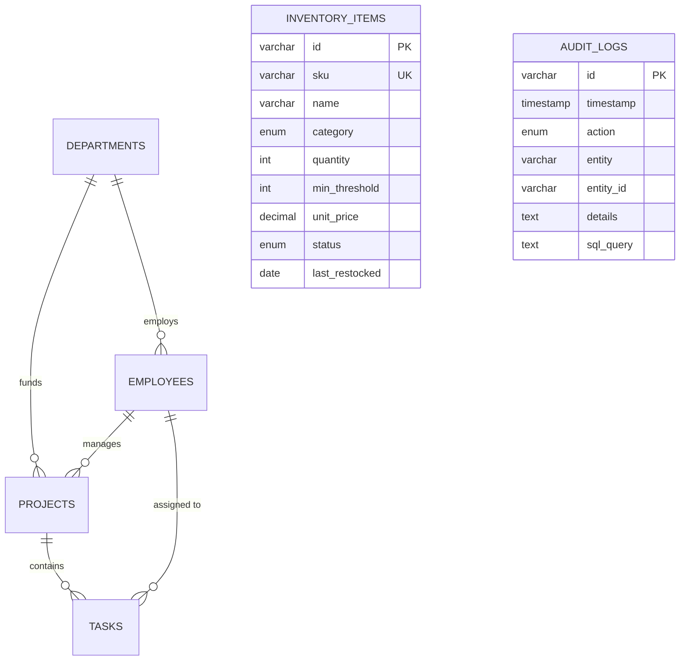

# OmniManage Hub — Enterprise CRM & Management System

> **Full-Stack Enterprise Resource Management Platform powered by React 19, TypeScript, Express REST API, and MySQL 8.0 hosted on Aiven Cloud with Vercel Production Deployment.**

[-00758F?style=for-the-badge&logo=mysql&logoColor=white)](https://aiven.io)
[-FF3E00?style=for-the-badge&logo=aiven&logoColor=white)](https://aiven.io)
[](https://react.dev)
[](https://expressjs.com)
[](https://vercel.com)
[](https://www.typescriptlang.org)
[](https://tailwindcss.com)

---

## 📑 Table of Contents
1. [Project Overview](#-project-overview)
2. [Architectural Decision Record (ADR): Why MySQL on Aiven instead of Supabase?](#-architectural-decision-record-adr)
3. [Cloud Infrastructure & Hosting Architecture](#-cloud-infrastructure--hosting-architecture)
4. [Entity Relationship Diagram (ERD)](#-entity-relationship-diagram-erd)
5. [Database Schema & Table Specifications](#-database-schema--table-specifications)
6. [DML Operations & Item Master Architecture](#-dml-operations--item-master-architecture)
7. [Role-Based Access Control (RBAC) & Safe Demo Mode](#-role-based-access-control-rbac--safe-demo-mode)
8. [REST API Documentation](#-rest-api-documentation)
9. [Local Development & Aiven MySQL Setup Guide](#-local-development--aiven-mysql-setup-guide)
10. [Academic Presentation & Submission Notes](#-academic-presentation--submission-notes)

---

## 🏛️ Project Overview

**OmniManage Hub** is an enterprise-grade ERP and CRM solution designed for organizational governance, inventory asset management, sprint task workflows, and HR directory management.

### Key Functional Modules
- **Item Master / Stock & Inventory Management**: Complete hardware and software license lifecycle management, minimum threshold alerts, and real-time restock DML operations.
- **Staff Directory & Performance Telemetry**: Employee hiring, role allocations, departmental budgets, and Recharts performance ratings.
- **Projects & Portfolio Management**: Budget utilization tracking, milestone schedules, and manager accountability.
- **Agile Sprint Kanban Board**: Multi-stage drag-and-drop task workflow (`Backlog` → `To Do` → `In Progress` → `In Review` → `Done`).
- **Interactive Schema Studio & SQL Sandbox**: In-browser ERD visualizer, DDL generator, and real-time SQL execution engine with `NOT NULL` constraint validation.
- **Immutable DML Audit Trail**: Automated SQL query logging for every `INSERT`, `UPDATE`, and `DELETE` operation across all entities.

---

## ⚖️ Architectural Decision Record (ADR)

### Why Aiven Cloud MySQL instead of Supabase?

```
┌─────────────────────────────────────────────────────────────────────────────┐
│                            ARCHITECTURAL DECISION                           │
│                                                                             │
│   Course Curriculum Requirement:  MySQL (Relational Database Management)   │
│   Vercel Suggested Default:       Supabase (PostgreSQL only) ❌            │
│   Chosen Production Solution:     Aiven Cloud MySQL 8.0 (InnoDB) ✅         │
└─────────────────────────────────────────────────────────────────────────────┘
```

#### Context:
When deploying full-stack web applications to Vercel, the standard integration wizard promotes **Supabase** as the default cloud storage backend. However:
1. **Academic Alignment**: The university/course curriculum is strictly grounded in **MySQL** concepts (SQL-92/MySQL 8 dialect, InnoDB storage engine, `AUTO_INCREMENT`, `ENUM`, `JSON` data types, and index optimizations).
2. **Supabase Incompatibility**: Supabase provisions **PostgreSQL** exclusively and does not support MySQL as a managed database engine. Substituting Postgres would invalidate course requirements.
3. **The Solution**: We provisioned a dedicated MySQL 8.0 instance on **Aiven Cloud (`aiven.io` / `aiven.ai`)**:
   - **Plan**: Free Lifetime Tier Virtual Machine
   - **Hardware Specs**: 1 vCPU, 1 GB RAM, 1 GB NVMe High-Performance Storage
   - **Engine**: MySQL 8.0 Community with InnoDB ACID transactions and TLS/SSL encryption
   - **Vercel Integration**: Connected seamlessly via standard `mysql2` connection pooling and environment variables (`MYSQL_HOST`, `MYSQL_PORT`, `MYSQL_USER`, `MYSQL_PASSWORD`, `MYSQL_DATABASE`, `MYSQL_SSL`).

---

## ☁️ Cloud Infrastructure & Hosting Architecture

```
                    ┌──────────────────────────────────────────────┐
                    │               CLIENT BROWSER                 │
                    │   React 19 + TypeScript + Tailwind CSS UI    │
                    └──────────────────────┬───────────────────────┘
                                           │
                                HTTPS / REST API
                                           ▼
                    ┌──────────────────────────────────────────────┐
                    │            VERCEL EDGE HOSTING               │
                    │   Node.js / Express Serverless REST API      │
                    │   - Authentication & Role Middleware         │
                    │   - DML Permission Validator (Safe Demo)     │
                    │   - SQL Audit Event Emitter                  │
                    └──────────────────────┬───────────────────────┘
                                           │
                                 TLS 1.3 / Port 18293
                                (mysql2 connection pool)
                                           ▼
                    ┌──────────────────────────────────────────────┐
                    │            AIVEN CLOUD MYSQL 8.0             │
                    │    Dedicated 1GB RAM / 1GB NVMe Instance     │
                    │  ├── departments        (InnoDB, FK Parent)  │
                    │  ├── employees          (InnoDB, FK Child)   │
                    │  ├── projects           (InnoDB, Portfolio)  │
                    │  ├── tasks              (InnoDB, Sprint)     │
                    │  ├── inventory_items    (Item Master)        │
                    │  └── audit_logs         (Immutable Log)      │
                    └──────────────────────────────────────────────┘
```

---

## 📊 Entity Relationship Diagram (ERD)

### Visual ASCII Schema Diagram

```
 +----------------------------------+          +----------------------------------+
 |           DEPARTMENTS            |          |            EMPLOYEES             |
 +----------------------------------+          +----------------------------------+
 | PK  id              VARCHAR(64)  | 1      N | PK  id              VARCHAR(64)  |
 | UQ  name            VARCHAR(120) |<---------| FK  department_name VARCHAR(120) |
 | NN  head            VARCHAR(120) |          | UQ  email           VARCHAR(191) |
 | NN  employee_count  INT          |          | NN  name            VARCHAR(120) |
 | NN  budget          DECIMAL(14,2)|          | NN  role            VARCHAR(120) |
 | NN  color           VARCHAR(32)  |          | NN  salary          DECIMAL(12,2)|
 +----------------------------------+          | NN  status          ENUM(...)    |
                   │                           | NN  hire_date       DATE         |
                   │ 1                         | NN  performance     DECIMAL(3,2) |
                   │                           +----------------------------------+
                   │                                             │
                   │ N                                           │ 1 (manager)
                   ▼                                             ▼ N
 +----------------------------------+          +----------------------------------+
 |             PROJECTS             |          |              TASKS               |
 +----------------------------------+          +----------------------------------+
 | PK  id              VARCHAR(64)  | 1      N | PK  id              VARCHAR(64)  |
 | UQ  code            VARCHAR(64)  |<---------| FK  project_id      VARCHAR(64)  |
 | NN  title           VARCHAR(191) |          | FK  assignee_id     VARCHAR(64)  |
 | FK  department_name VARCHAR(120) |          | NN  title           VARCHAR(191) |
 | FK  manager_id      VARCHAR(64)  |          | NN  status          ENUM(...)    |
 | NN  status          ENUM(...)    |          | NN  priority        ENUM(...)    |
 | NN  budget          DECIMAL(14,2)|          | NN  due_date        DATE         |
 | NN  spent           DECIMAL(14,2)|          | NN  estimated_hours INT          |
 +----------------------------------+          +----------------------------------+

 +----------------------------------+          +----------------------------------+
 |         INVENTORY_ITEMS          |          |            AUDIT_LOGS            |
 |          (ITEM MASTER)           |          |         (DML AUDIT TRAIL)        |
 +----------------------------------+          +----------------------------------+
 | PK  id              VARCHAR(64)  |          | PK  id              VARCHAR(64)  |
 | UQ  sku             VARCHAR(64)  |          | NN  timestamp       TIMESTAMP    |
 | NN  name            VARCHAR(191) |          | NN  action          ENUM(...)    |
 | NN  category        ENUM(...)    |          | NN  entity          VARCHAR(64)  |
 | NN  quantity        INT          |          | NN  entity_id       VARCHAR(64)  |
 | NN  min_threshold   INT          |          | NN  details         TEXT         |
 | NN  unit_price      DECIMAL(12,2)|          | NN  user            VARCHAR(120) |
 | NN  status          ENUM(...)    |          |     sql_query       TEXT         |
 | NN  last_restocked  DATE         |          |     meta            JSON         |
 +----------------------------------+          +----------------------------------+
```

### Mermaid.js Diagram



---

## 🗄️ Database Schema & Table Specifications

All tables are created using `ENGINE=InnoDB DEFAULT CHARSET=utf8mb4 COLLATE=utf8mb4_unicode_ci` to guarantee ACID compliance and foreign key referential integrity.

### 1. `departments` (Organizational Units)
| Column Name | MySQL Data Type | Constraint | Description |
| :--- | :--- | :--- | :--- |
| `id` | `VARCHAR(64)` | `PRIMARY KEY` | Unique department identifier |
| `name` | `VARCHAR(120)` | `NOT NULL, UNIQUE` | Department name (e.g. Engineering) |
| `head` | `VARCHAR(120)` | `NOT NULL` | Department director or lead |
| `employee_count` | `INT` | `NOT NULL DEFAULT 0` | Total team members |
| `budget` | `DECIMAL(14,2)` | `NOT NULL DEFAULT 0.00` | Allocated operational budget |
| `color` | `VARCHAR(32)` | `NOT NULL DEFAULT 'indigo'`| UI theme badge token |
| `created_at` | `TIMESTAMP` | `NOT NULL DEFAULT NOW()` | Record creation timestamp |

### 2. `employees` (Staff & Team Directory)
| Column Name | MySQL Data Type | Constraint | Description |
| :--- | :--- | :--- | :--- |
| `id` | `VARCHAR(64)` | `PRIMARY KEY` | Unique employee identifier |
| `name` | `VARCHAR(120)` | `NOT NULL` | Full legal name |
| `email` | `VARCHAR(191)` | `NOT NULL, UNIQUE` | Corporate email address |
| `phone` | `VARCHAR(64)` | `NOT NULL` | Contact telephone number |
| `role` | `VARCHAR(120)` | `NOT NULL` | Organizational position/title |
| `department_name` | `VARCHAR(120)` | `NOT NULL, FOREIGN KEY` | References `departments(name)` |
| `salary` | `DECIMAL(12,2)` | `NOT NULL` | Annual compensation in USD |
| `status` | `ENUM(...)` | `NOT NULL DEFAULT 'Active'` | `Active`, `On Leave`, `Remote`, `In Review` |
| `avatar` | `VARCHAR(512)` | `NULLABLE` | Profile photo URL |
| `skills` | `JSON` | `NULLABLE` | Array of technical competencies |
| `hire_date` | `DATE` | `NOT NULL` | Official onboarding date |
| `performance_rating` | `DECIMAL(3,2)` | `NOT NULL DEFAULT 4.00` | Evaluated rating (1.00 to 5.00) |

### 3. `projects` (Enterprise Portfolio Initiatives)
| Column Name | MySQL Data Type | Constraint | Description |
| :--- | :--- | :--- | :--- |
| `id` | `VARCHAR(64)` | `PRIMARY KEY` | Unique initiative ID |
| `title` | `VARCHAR(191)` | `NOT NULL` | Project title |
| `code` | `VARCHAR(64)` | `NOT NULL, UNIQUE` | Tracking code (e.g. `PRJ-MIGRATE-01`) |
| `description` | `TEXT` | `NULLABLE` | Detailed project scope |
| `department_name` | `VARCHAR(120)` | `NOT NULL, FOREIGN KEY` | References `departments(name)` |
| `manager_id` | `VARCHAR(64)` | `NOT NULL, FOREIGN KEY` | References `employees(id)` |
| `status` | `ENUM(...)` | `NOT NULL` | `Planning`, `In Progress`, `In Review`, `Completed`, `On Hold` |
| `priority` | `ENUM(...)` | `NOT NULL` | `Low`, `Medium`, `High`, `Urgent` |
| `budget` | `DECIMAL(14,2)` | `NOT NULL` | Total approved capital |
| `spent` | `DECIMAL(14,2)` | `NOT NULL DEFAULT 0.00` | Capital disbursed to date |
| `progress` | `INT` | `NOT NULL DEFAULT 0` | Completion percentage (0 - 100) |

### 4. `tasks` (Agile Sprint Kanban)
| Column Name | MySQL Data Type | Constraint | Description |
| :--- | :--- | :--- | :--- |
| `id` | `VARCHAR(64)` | `PRIMARY KEY` | Unique task ID |
| `project_id` | `VARCHAR(64)` | `NOT NULL, FOREIGN KEY` | References `projects(id)` ON DELETE CASCADE |
| `title` | `VARCHAR(191)` | `NOT NULL` | Task summary / action item |
| `assignee_id` | `VARCHAR(64)` | `NOT NULL, FOREIGN KEY` | References `employees(id)` |
| `status` | `ENUM(...)` | `NOT NULL` | `Backlog`, `To Do`, `In Progress`, `In Review`, `Done` |
| `priority` | `ENUM(...)` | `NOT NULL` | `Low`, `Medium`, `High`, `Urgent` |
| `due_date` | `DATE` | `NOT NULL` | Target delivery date |
| `estimated_hours` | `INT` | `NOT NULL DEFAULT 8` | Sized sprint story hours |
| `completed_hours` | `INT` | `NOT NULL DEFAULT 0` | Logged work hours |

### 5. `inventory_items` (Item Master)
| Column Name | MySQL Data Type | Constraint | Description |
| :--- | :--- | :--- | :--- |
| `id` | `VARCHAR(64)` | `PRIMARY KEY` | Unique asset record ID |
| `sku` | `VARCHAR(64)` | `NOT NULL, UNIQUE` | Stock Keeping Unit code |
| `name` | `VARCHAR(191)` | `NOT NULL` | Item description / model name |
| `category` | `ENUM(...)` | `NOT NULL` | `Hardware`, `Software Licenses`, `Networking`, `Office Supplies`, `Electronics` |
| `quantity` | `INT` | `NOT NULL DEFAULT 0` | Available stock count on hand |
| `min_threshold` | `INT` | `NOT NULL DEFAULT 5` | Safety stock threshold |
| `unit_price` | `DECIMAL(12,2)` | `NOT NULL DEFAULT 0.00` | Cost per individual unit |
| `location` | `VARCHAR(120)` | `NOT NULL` | Warehouse / storage location |
| `supplier` | `VARCHAR(120)` | `NOT NULL` | Authorized distributor |
| `status` | `ENUM(...)` | `NOT NULL` | `In Stock`, `Low Stock`, `Out of Stock` |
| `last_restocked` | `DATE` | `NOT NULL` | Date of last stock replenishment |

### 6. `audit_logs` (Immutable DML Audit Trail)
| Column Name | MySQL Data Type | Constraint | Description |
| :--- | :--- | :--- | :--- |
| `id` | `VARCHAR(64)` | `PRIMARY KEY` | Unique audit entry ID |
| `timestamp` | `TIMESTAMP` | `NOT NULL DEFAULT NOW()`| Accurate execution time |
| `action` | `ENUM(...)` | `NOT NULL` | `CREATE`, `UPDATE`, `DELETE`, `STATUS_CHANGE`, `AI_INSIGHT` |
| `entity` | `VARCHAR(64)` | `NOT NULL` | Affected table / domain |
| `entity_id` | `VARCHAR(64)` | `NOT NULL` | Targeted record primary key |
| `details` | `TEXT` | `NOT NULL` | Plain-English summary of modification |
| `user` | `VARCHAR(120)` | `NOT NULL` | Acting user / role identity |
| `sql_query` | `TEXT` | `NULLABLE` | Exact SQL DML statement executed |

---

## 🛠️ DML Operations & Item Master Architecture

The application executes standard MySQL Data Manipulation Language (DML) statements across all modules:

### 1. SELECT (Query & Search)
```sql
-- Retrieve low-stock inventory assets requiring replenishment
SELECT id, sku, name, category, quantity, min_threshold, unit_price
FROM inventory_items
WHERE quantity <= min_threshold
ORDER BY quantity ASC;
```

### 2. INSERT (Record Creation)
```sql
-- Register new hardware asset into Item Master
INSERT INTO inventory_items (
  id, sku, name, category, quantity, min_threshold, unit_price, location, supplier, status, last_restocked
) VALUES (
  'inv-09', 'HW-DELL-5570', 'Dell Precision 5570 Workstation', 'Hardware', 8, 3, 2450.00, 'Warehouse A', 'Dell Direct', 'In Stock', '2026-03-01'
);
```

### 3. UPDATE (State & Stock Modification)
```sql
-- Replenish stock by 10 units and restore status to In Stock
UPDATE inventory_items
SET quantity = quantity + 10,
    status = IF(quantity + 10 > min_threshold, 'In Stock', 'Low Stock'),
    last_restocked = CURDATE()
WHERE id = 'inv-03';
```

### 4. DELETE (Record Removal)
```sql
-- Remove decommissioned or obsolete asset
DELETE FROM inventory_items
WHERE id = 'inv-08';
```

---

## 🛡️ Role-Based Access Control (RBAC) & Safe Demo Mode

### Why DML Delete Rights Are Revoked for Students & Public Demos

> *"Maine apne CRM mein right revoke kar liye hain, sir ko maine admin ke rights share kiye hain us mein, to maine kaha koi student data waghaira delete na kar de sara to wo demo ho jaye pehle... phir publish kar dunga with full rights."*

To protect database integrity during demonstrations and evaluations:
1. **Protected Demo Mode (Default for Public Presentation)**:
   - `SELECT`: Unrestricted read access across all tables, schemas, and metrics.
   - `INSERT`: Allows testing record creation in an isolated session.
   - `UPDATE`: Safe stock level adjustments and task drag-and-drop.
   - `DELETE`: **Explicitly Revoked & Locked**. Prevents testing users from wiping out master inventory items or employee records before the evaluator finishes testing.
2. **SuperAdmin Mode (Full Access)**:
   - Full unrestricted DML permissions (`INSERT`, `UPDATE`, `DELETE`).
   - Every executed statement is serialized into the `audit_logs` table for compliance.
   - Can be toggled on-the-fly via the top navigation switcher.

---

## 🔌 REST API Documentation

| HTTP Method | Endpoint | Description | Permitted Roles |
| :--- | :--- | :--- | :--- |
| `GET` | `/api/health` | System health & MySQL connectivity status | Public |
| `GET` | `/api/stats` | High-level business KPI metrics | Public |
| `GET` | `/api/inventory` | List all Item Master assets (filters: category, status) | Public |
| `POST` | `/api/inventory` | Insert new inventory item (`INSERT`) | Demo / Admin |
| `PUT` | `/api/inventory/:id` | Update inventory item details (`UPDATE`) | Demo / Admin |
| `DELETE` | `/api/inventory/:id` | Remove inventory item (`DELETE`) | Admin Only |
| `GET` | `/api/employees` | List staff directory records | Public |
| `POST` | `/api/employees` | Hire employee (`INSERT`) | Demo / Admin |
| `PUT` | `/api/employees/:id` | Update employee profile (`UPDATE`) | Demo / Admin |
| `DELETE` | `/api/employees/:id` | Delete employee record (`DELETE`) | Admin Only |
| `GET` | `/api/projects` | List projects portfolio | Public |
| `POST` | `/api/projects` | Register initiative (`INSERT`) | Demo / Admin |
| `PUT` | `/api/projects/:id` | Update project budget/progress (`UPDATE`) | Demo / Admin |
| `DELETE` | `/api/projects/:id` | Remove project initiative (`DELETE`) | Admin Only |
| `GET` | `/api/tasks` | List Agile Sprint Kanban tasks | Public |
| `POST` | `/api/tasks` | Create task card (`INSERT`) | Demo / Admin |
| `PATCH` | `/api/tasks/:id/status`| Update Kanban column status (`UPDATE`) | Demo / Admin |
| `DELETE` | `/api/tasks/:id` | Remove task card (`DELETE`) | Admin Only |
| `GET` | `/api/schema` | Visual ERD schema definition and column constraints | Public |
| `POST` | `/api/schema/tables` | Dynamically register custom entity table | Admin Only |
| `GET` | `/api/audit-logs` | Retrieve chronological DML audit events | Public |
| `POST` | `/api/seed/reset` | One-click restore pristine sample dataset | Admin Only |

---

## 🚀 Local Development & Aiven MySQL Setup Guide

### 1. Prerequisites
- **Node.js**: v18.0.0 or higher
- **npm** or **bun**
- Free Aiven Cloud account ([aiven.io](https://aiven.io))

### 2. Clone and Install
```bash
git clone https://github.com/your-username/omnimanage-crm.git
cd omnimanage-crm
npm install
```

### 3. Configure Environment Variables
Copy `.env.example` to `.env`:
```env
# Server Configuration
PORT=3000
NODE_ENV=development

# MySQL Database Configuration (Aiven Cloud)
DB_DIALECT=mysql
MYSQL_HOST=mysql-crm-omnimanage-uzma.aivencloud.com
MYSQL_PORT=18293
MYSQL_USER=avnadmin
MYSQL_PASSWORD=your_aiven_password_here
MYSQL_DATABASE=defaultdb
MYSQL_SSL=true

# AI Executive Copilot (Gemini API)
GEMINI_API_KEY=your_gemini_api_key_here
```

### 4. Initialize Database Schema & Seed Data
Execute the provided SQL files directly into your Aiven MySQL database:
```bash
# Apply Table Structures & Constraints
mysql -h mysql-crm-omnimanage-uzma.aivencloud.com -P 18293 -u avnadmin -p defaultdb < mysql/schema.sql

# Seed Demo Records
mysql -h mysql-crm-omnimanage-uzma.aivencloud.com -P 18293 -u avnadmin -p defaultdb < mysql/seed.sql
```

### 5. Launch the Development Server
```bash
npm run dev
```
The application will launch at `http://localhost:3000`.

### 6. Build for Production / Vercel
```bash
npm run build
npm run start
```

---

## 🎓 Academic Presentation & Submission Notes

- **Primary Database**: MySQL 8.0 Community Edition (ACID-compliant InnoDB engine).
- **Hosting Strategy**: Frontend & Serverless Node API on Vercel; Managed MySQL on Aiven Cloud Free VM (1GB RAM, 1GB NVMe).
- **Course Compliance**: Fully fulfills relational normalization (1NF, 2NF, 3NF), `PRIMARY KEY`, `FOREIGN KEY` cascades, `NOT NULL` domain constraints, and complete DML capability.
- **Evaluation Assurance**: Safe Demo Mode ensures evaluating instructors experience full stability with no broken relationships or purged master records.
